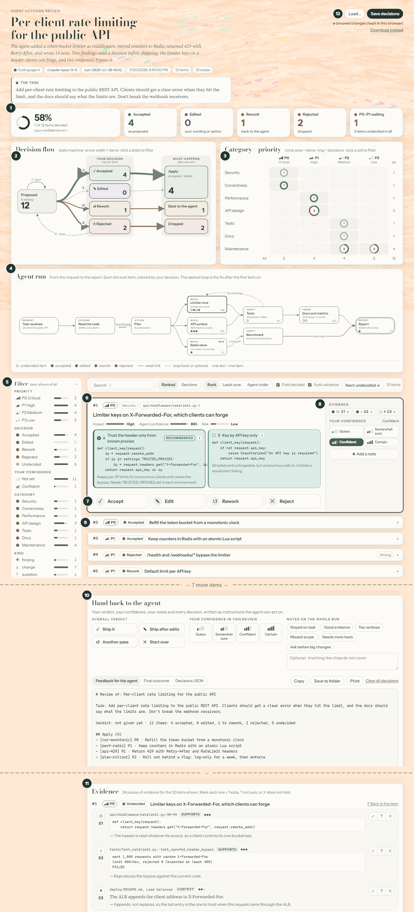

# review-everything

One page for reviewing what an agent produced, such as code changes, findings, plans, document edits, or a paper review. You decide each item, and the page writes feedback the agent can act on.

## Install the review-first plugin

The same plugin works with local Codex and Claude Code. Use a current client, Git, and Node.js 20 or later on `PATH`.

### Codex

```sh
codex plugin marketplace add HangYu8123/review-everything
codex plugin add agent-review@agent-review-local
```

Start a new local Codex session. Open `/hooks` in the CLI, or **Settings → Hooks** in the desktop app, and trust the hooks from **Agent Review Desk**. Review them again if Codex prompts after an update.

### Claude Code

```sh
claude plugin install agent-review --marketplace HangYu8123/review-everything
```

Start a new Claude Code session. To try a local checkout for one session, run `claude --plugin-dir "<absolute path to the checkout>"` from the project you want to work on.

### Review and apply

1. Ask for a change as usual. The agent prepares `wait-for-review/<review-id>/review.html` at the project root and gives you its link.
2. Open the page, decide the items, and click **Save decisions**. If the browser downloads the JSON, move it into the review's folder with its original filename.
3. Tell the agent `Apply review <review-id>` to apply the accepted changes from the latest save. The plugin applies Git patches and relays accepted manual actions to the agent.

Start a request with `Just do it:` to skip review for that request. Read-only questions can be answered directly. The hook allows review artifacts and common read-only commands. It blocks unreviewed writes and other commands through the tool calls the client exposes to hooks. The workflow runs in local sessions with hooks enabled and is subject to each client's hook coverage and permissions.

### Local files and network requests

The hooks run bundled Node.js scripts and use Git to locate the project and apply approved patches. They record the selected review mode and project path in local plugin data. Proposals and saved decisions stay in the project's review folder until you move or remove them. The page stores autosave state in the browser, and it can request typefaces from Google Fonts. The page does not send review content or decisions to Google Fonts.

## Use it

Ask the agent for a review, for example "Put these changes up for review with the template in `agent_review_template/`." Open the resulting `review.html`, decide the items, click **Save decisions**, and tell the agent to act on the decisions file saved next to the page.

### Build a review page

1. Copy this folder’s `review.html` unchanged to `wait-for-review/<review_id>/` at the project root, or to the folder named by the reviewer. See the bundled [example review data](review-data.js).
2. Write the proposals, alternatives, and evidence in the adjacent `review-data.js` using the spec in the HTML header. Put any interactive design preview in a `preview/` subfolder and link to it from the approval page’s evidence.
3. From the project root, run `node "<plugin checkout>/check_review.js" wait-for-review/<review_id>/review-data.js --verify-page`. Open the result at desktop and phone widths and check that each expanded item shows its decision buttons and **Your confidence** choices.

## What is on the page



1. **Progress.** Share of items decided, and counts per decision.
2. **Decision flow.** The review as a state machine, with live counts.
3. **Category × priority.** Items by category and priority, as a clickable filter.
4. **Agent run.** The agent's run as a state machine, one dot per item.
5. **Filters.** Priority, decision, confidence, category, and kind, with bar counts.
6. **Item.** Impact, agent confidence, and risk under the title, then the proposal or options to choose between.
7. **Decision.** Accept, Edit, Rework, or Reject.
8. **Rail.** Evidence links, your confidence, and a note. On phones, **Your confidence** appears immediately above the decision buttons.
9. **Decided items.** Folded to one line.
10. **Hand back.** Overall verdict, your confidence, run notes, and the feedback for the agent.
11. **Evidence.** Each piece marked ✓ holds, ? not sure, or ✕ does not hold.
12. **Save.** Decisions saved into the page's own folder.

**Also.** A Sections layout for paper reviews, bulk decide, keyboard keys (`a e w r` decide, `j k` move), undo, and autosave.

**Reviewer confidence** starts unset on each item. The reviewer can pick a rating before deciding or after reopening the card. The decisions JSON and feedback Markdown include the selected rating. Use `confidence_levels` to customize the labels. An item’s `confidence` field supplies the agent’s estimate.

## Files

| File | What it is |
| --- | --- |
| `review.html` | The page. Copy it unchanged. Its header comment holds the data spec. |
| `review-data.js` | Example data, a coding agent's rate-limiting change (the page in the image) |
| `check_review.js` | Checks `review-data.js`. The `--verify-page` option also checks the adjacent HTML against the template. |
| `screenshot.png` | The image above |
| `hooks/` and `skills/review-first/` | The review-first workflow for both clients. |
| `scripts/review.cjs` | Creates the page, checks it, and applies accepted patches. |
